

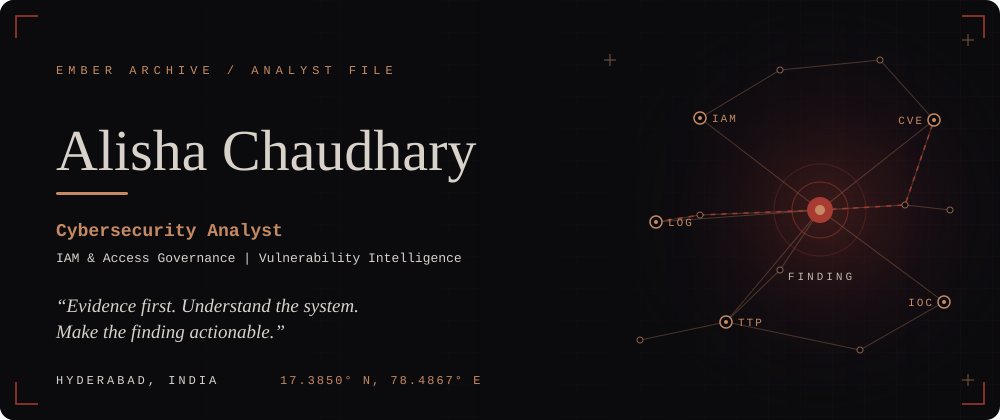

 

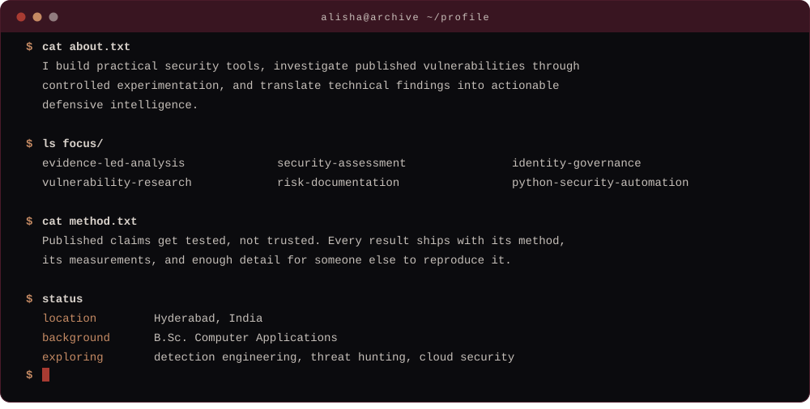

 

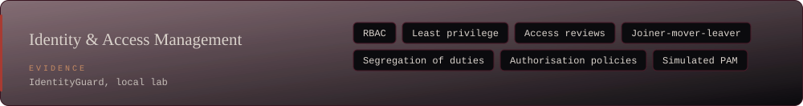

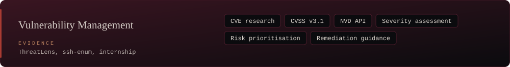

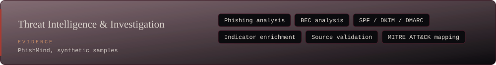

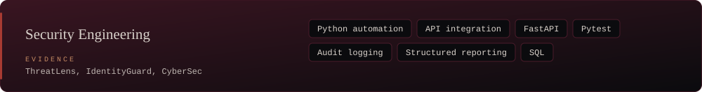

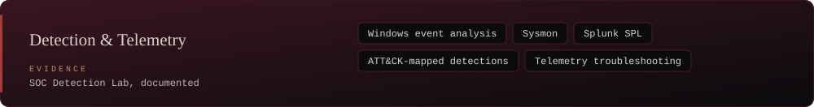

 

<a href="https://github.com/Alisha-chaudhary/ThreatLens">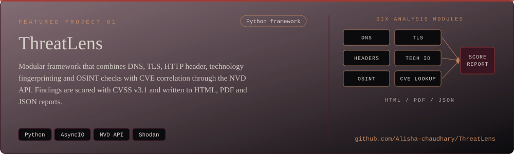</a>

<a href="https://github.com/Alisha-chaudhary/IdentityGuard">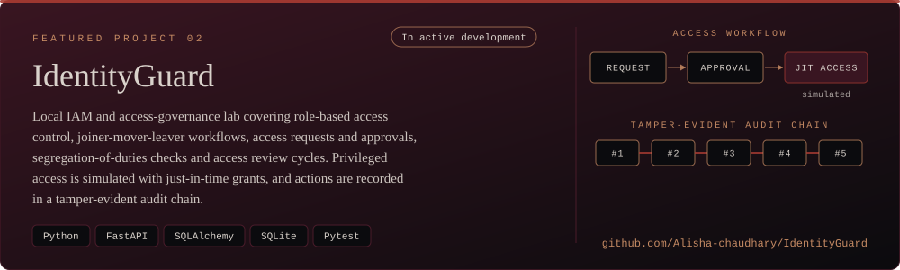</a>

<a href="https://github.com/Alisha-chaudhary/PhishMind">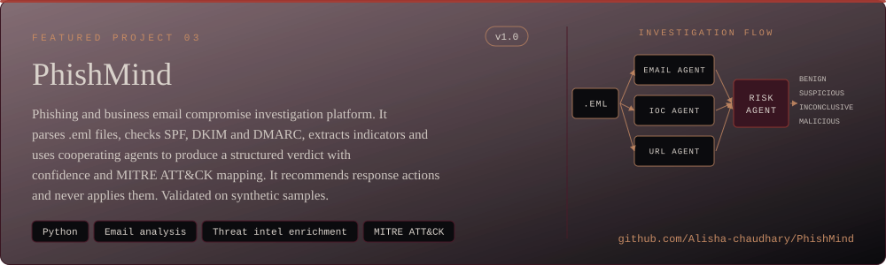</a>

<a href="https://github.com/Alisha-chaudhary/ssh-enum">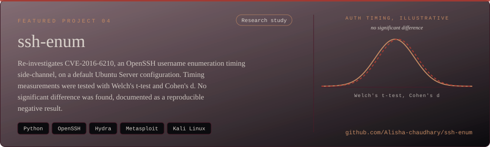</a>

 

**Also in the archive**

<a href="https://github.com/Alisha-chaudhary/CTF-Writeups">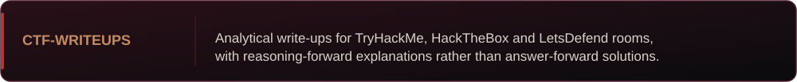</a>

<a href="https://github.com/Alisha-chaudhary/CyberSec">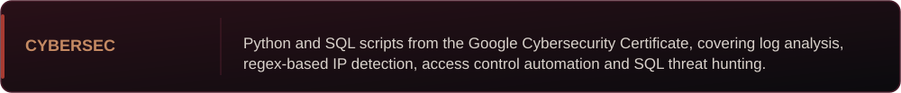</a>

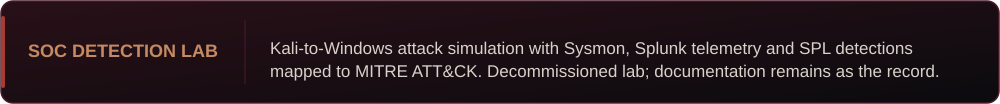

<!-- When the SOC Detection Lab repository is public, link its card above. -->

 


 

 

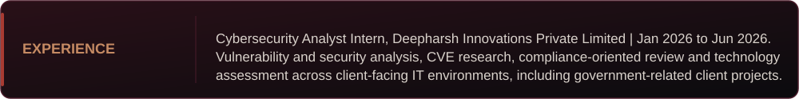

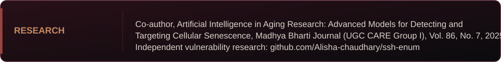

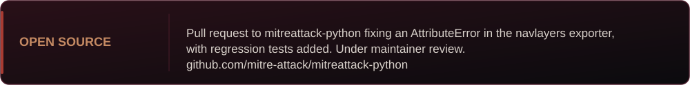

<a href="https://github.com/Alisha-chaudhary/ssh-enum">ssh-enum research</a>
&nbsp;·&nbsp;
<a href="https://github.com/mitre-attack/mitreattack-python">mitreattack-python contribution</a>

 

If the statistics cards do not load, the numbers live on the <a href="https://github.com/Alisha-chaudhary">profile page</a>.

 

